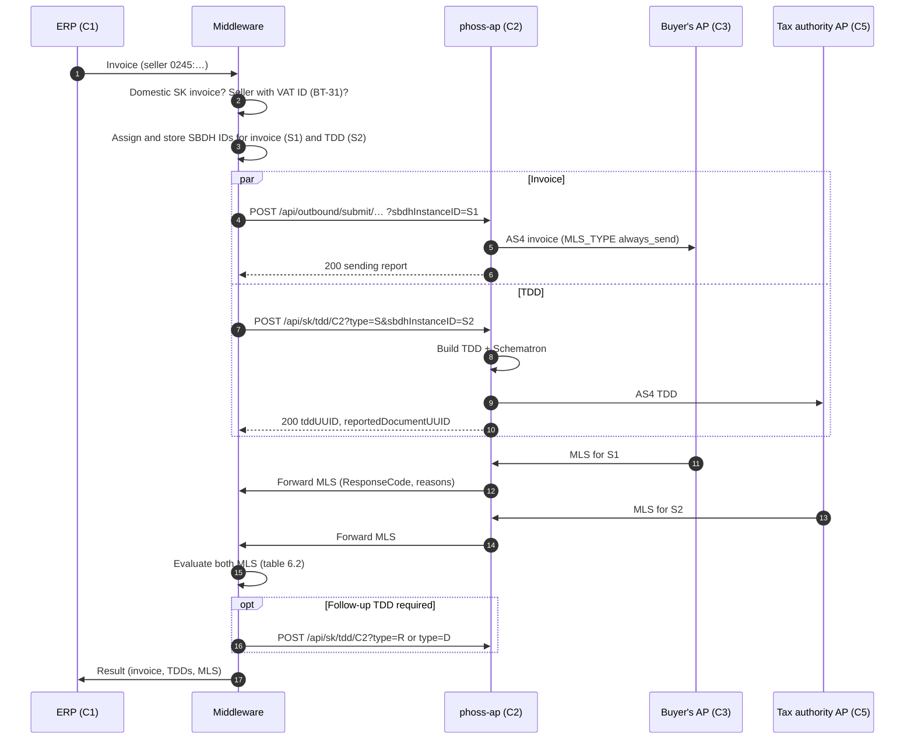
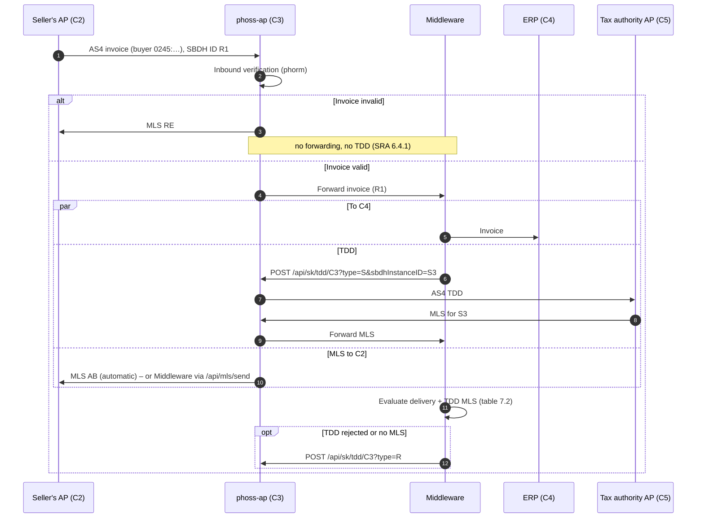

# Peppol SK – TDD APIs and the Middleware process

This page describes how the Middleware handles the Slovak tax reporting (**SK Tax Data Document,
TDD**) through the Access Point: which APIs the AP provides and which process the Middleware must
follow as **C2** (the seller's AP) and as **C3** (the buyer's AP).

- **Business basis:** OpenPeppol, *Slovakia Solution Reference Architecture* (SRA) v1.2. Section
  and page references below refer to it.
- **Analysis and gap list:** [FR-008](https://github.com/RostigerN4gel/peppol-helper/blob/main/docs/feature-requests/FR-008-peppol-sk-tax-reporting.md)
  in the peppol-helper repository.
- **Implementation in the AP:** [CUSTOMIZATIONS.md – Peppol SK TDD](CUSTOMIZATIONS.md#peppol-sk-tax-data-document-tdd-fork-specific).
- **German version:** [SK-TDD-MIDDLEWARE.md](SK-TDD-MIDDLEWARE.md).

> [!IMPORTANT]
> According to its author, the TDD library (`com.helger.peppol:peppol-sk-tdd` 0.2.2) is still *work
> in progress* for the member review of the SK TDD specification. The data model and the rules may
> still change before the start on **2027-01-01**.

---

## 1. When does this apply?

A TDD is only required if the AP serves **Slovak end users** (participants
`iso6523-actorid-upis::0245:<DIČ>`) and a **domestic** invoice is exchanged between two Slovak
parties. Invoices with Slovak partners, without own SK end users, need no TDD (SRA Table 5).

| Role of the AP | Who reports | Condition for a TDD (SRA) |
|---|---|---|
| **C2** – we send the invoice | the seller (C1) | the seller has a VAT ID (BT-31) |
| **C3** – we receive the invoice | the buyer (C4) | the invoice is valid **and** the buyer has a VAT ID (BT-48) |

Until the end of the transition phase (2030 according to the SRA), cross-border invoices are not
reported. The sources partly contradict each other here (FR-008, K1–K5), so the Middleware should
keep these rules configurable.

---

## 2. Division of work

| Task | AP | Middleware |
|---|---|---|
| Send / receive the invoice via AS4 | ✅ | triggers it / takes it over |
| Receive the MLS from C3 or C5 and correlate it with the transmission | ✅ (status API, forwarding to the Middleware) | evaluates it |
| Send the MLS to C2 (role C3) | ✅ automatically, optionally via API | decides with `mls.sending.trigger=api` |
| Create the TDD from the invoice (incl. the Invoice UUID v5) | ✅ `POST /api/sk/tdd` | calls it |
| Validate the TDD with the Schematron and send it to C5 | ✅ | – |
| Decide **whether and when** a TDD is due (`S`, `R`, `D`) | – | ✅ |
| Evaluate the MLS of invoice and TDD **together** (SRA Table 1 / 2) | – | ✅ |
| SLA timers and follow-up TDDs | – | ✅ |
| Store the link invoice ↔ TDDs, inform C1/C4 | – | ✅ |

The AP knows **no** link between an invoice and its TDDs. To the AP, every TDD is an independent
outbound transaction. The Middleware must keep the link itself; the AP provides the identifiers
needed for it (section 3).

---

## 3. Identifiers

| Identifier | Created by | Used for |
|---|---|---|
| **SBDH Instance Identifier of the invoice** | Middleware (recommended) or AP | correlating the MLS from C3 with the invoice (C2). As C3: the reference of the MLS to C2 |
| **SBDH Instance Identifier of the TDD** | Middleware (recommended) or AP | correlating the MLS from C5 with the TDD |
| **Invoice UUID v5** (`reportedDocumentUUID`) | the AP while building the TDD (SRA 9.2.3) | business key of the invoice. Identical for C2 and C3, the same for `S` and `R` |
| **TDD UUID** (`tddUUID`) | the AP (random UUID v4) or the Middleware | ID of a single TDD, new for every TDD |
| AP transaction ID (`outboundTransactionID`) | AP | internal ID, for status queries and operations |

**Recommendation:** the Middleware assigns the SBDH Instance Identifiers itself (parameter
`sbdhInstanceID`, a UUID) and stores them before the call. It can then correlate every incoming MLS
reliably, even if the HTTP response of the AP gets lost.

Fixed values (SRA 9.1–9.3):

| What | Value |
|---|---|
| Document type of the TDD | `busdox-docid-qns::urn:peppol:schema:sk-taxdata:1.0::TaxData##urn:peppol:taxdata:sk-1::1.0` |
| Process of the TDD | `cenbii-procid-ubl::urn:peppol:taxreporting` |
| Receiver of the TDD (C5, test pilot) | `iso6523-actorid-upis::0242:000357-TaxAuthority.SK` (configurable in the AP) |
| End users | `iso6523-actorid-upis::0245:<DIČ>` |
| Substitute participant | `iso6523-actorid-upis::0245:9970300001` – TDD only, no invoice (SRA 5.5) |

---

## 4. AP configuration

```properties
# Enable the TDD endpoint (default: off, it then answers with 404)
sk.tdd.enabled=true
# Mandatory: this AP as the reporter's representative (SK AP ID, scheme 0242)
sk.tdd.reporters-representative.participant-id=iso6523-actorid-upis::0242:<ID>
# Defaults
#sk.tdd.tax-authority.participant-id=iso6523-actorid-upis::0242:000357-TaxAuthority.SK
#sk.tdd.tax-authority.id=SK
#sk.tdd.c1-country-code=SK

# Do not set: invoices and TDDs need MLS_TYPE always_send (default)
#mls.type=

# Role C3: answer invalid invoices with RE and do NOT forward them (SRA 6.4.1)
verification.inbound.enabled=true
verification.inbound.rejection-forwarding=none

# Optional, role C3: the Middleware decides the MLS to C2 itself (section 7.1)
#mls.sending.trigger=api
```

- **`mls.type`:** the AP writes the global `mls.type` into the SBDH of **every** outbound
  transmission. The SRA requires `ALWAYS_SEND` for every TDD and recommends it for SK invoices,
  because with `FAILURE_ONLY` "no message" cannot be told apart from "message lost". If `mls.type`
  is set to something else, `POST /api/sk/tdd` returns a `warning` field.
- **Inbound verification:** without it, the AP also forwards invalid invoices to the Middleware.
  With `mls.sending.trigger=auto` (default), it has then already sent a positive MLS before the
  Middleware can check the invoice. In addition: if phorm also checks outbound documents
  (`verification.outbound.enabled=true`), this applies to TDDs as well.
- **New upstream behavior (0.13.2):** for **inbound** invoices, the `MLS_TYPE` from the sender's
  SBDH applies. If it is missing, `FAILURE_ONLY` applies and the AP sends no positive MLS as C3.

---

## 5. API reference

All calls go to `https://<ap-host>` and need the header `X-Token: <phase4.api.requiredtoken>`.

### 5.1 `POST /api/sk/tdd/{reporterRole}` – create and send a TDD

Request body: the **UBL 2.1 invoice** (`Invoice`) or **credit note** (`CreditNote`) as XML,
**without an SBDH**. As C3, the Middleware receives the invoice wrapped in the SBD, depending on the
forwarding (section 5.4), and must extract the business document first.

| Parameter | Mandatory | Default | Meaning |
|---|---|---|---|
| `reporterRole` (path) | yes | – | `C2` (reporting for the seller) or `C3` (for the buyer) |
| `type` | no | `S` | `S` = submit, `R` = resubmit, `D` = disregard |
| `scope` | no | `D` | `D` = domestic, `IC` = intra-community, `INTL` = international |
| `reportingParty` | no | `EndpointID` of the seller (C2) or buyer (C3) | Peppol ID of the reporting party. Also the SBDH sender of the TDD. Set it if the invoice has no suitable `EndpointID` |
| `tddUUID` | no | random UUID v4 | UUID of the TDD |
| `sbdhInstanceID` | no | random | SBDH Instance Identifier of the TDD transmission (recommended, section 3) |
| `send` | no | `true` | `false` = dry run: only build and validate, the TDD is returned as `tddXML`, nothing is sent |
| `custom1`…`custom3` | no | – | max. 255 characters, stored with the transaction (e.g. your own case number) |

Example:

```bash
curl -s -X POST \
     -H "X-Token: <token>" -H "Content-Type: application/xml" \
     --data-binary @invoice.xml \
     "https://<ap-host>/api/sk/tdd/C2?type=S&scope=D&sbdhInstanceID=7f1c2a9e-3b4d-4e5f-8a6b-1c2d3e4f5a6b&custom1=VORGANG-4711"
```

Response **200** (sent, AS4 receipt from C5 received):

```json
{
  "tddUUID": "0d6d1b5e-6c6e-4c55-9d07-3c2c1d1f8a10",
  "reportedDocumentUUID": "1780de4f-a87c-50cc-9d8a-f982abe36912",
  "taxDataTypeCode": "S",
  "documentScope": "D",
  "reporterRole": "C2",
  "reportingParty": "iso6523-actorid-upis::0245:2020123456",
  "receiver": "iso6523-actorid-upis::0242:000357-TaxAuthority.SK",
  "sbdhInstanceID": "7f1c2a9e-3b4d-4e5f-8a6b-1c2d3e4f5a6b",
  "outboundTransactionID": "…",
  "sendingReport": { … }
}
```

Additional fields where applicable: `validationWarnings` (Schematron warnings, the TDD was sent
anyway), `warning` (`mls.type` is not `always_send`), and with `send=false` the field `tddXML`
instead of `sbdhInstanceID`, `outboundTransactionID` and `sendingReport`.

| HTTP | Meaning | Reaction of the Middleware |
|---|---|---|
| **200** | TDD built, valid and transmitted to C5 (AS4 receipt) | store `sbdhInstanceID`, `tddUUID` and `reportedDocumentUUID`, wait for the MLS from C5 |
| **400** | invalid parameter, the body is no UBL invoice / credit note, reporting party without `EndpointID` | fix the call. No retry without a change |
| **401** | token missing or wrong | check the configuration |
| **404** | `sk.tdd.enabled=false` or sending is disabled in the AP | inform AP operations |
| **422 without `outboundTransactionID`** | TDD cannot be built (mandatory field missing), Schematron errors (`issues`), or rejected by the outbound verification | fix the invoice or the data. **Nothing was sent** |
| **422 with `outboundTransactionID`** | TDD accepted, but the **first sending attempt** to C5 failed (`sendingReport`) | **Do not resubmit.** The AP retries itself (`retry.sending.*`). Track the status via 5.2 |
| **500** | AP configuration missing or wrong (e.g. `reporters-representative`) | inform AP operations |

### 5.2 `GET /api/outbound/status/{sbdhInstanceID}` – status of a transmission

Applies to the invoice (C2) and to every TDD. Important fields:

| Field | Values |
|---|---|
| `status` | `pending`, `sending`, `sent`, `failed` (the AP retries, `nextRetryDT`), `permanently_failed` (finally undeliverable), `rejected` (rejected by the outbound verification) |
| `mlsStatus` | `pending` (no MLS yet), `received_ap`, `received_ab`, `received_re` |
| `errorDetails` | last error with `failed` / `permanently_failed` |
| `custom1`…`custom3` | the values passed on submission |

`mlsStatus` only returns the response code. The Middleware sees the **reason** for a rejection
(e.g. `FD`) only in the MLS itself (5.4).

### 5.3 `POST /api/outbound/submit/{senderID}/{receiverID}/{docTypeID}/{processID}/{c1CountryCode}` – send the invoice (C2)

The existing interface for outbound documents, unchanged. For SK invoices:
`senderID` = `0245:<DIČ of the seller>`, `c1CountryCode` = `SK`, assign `sbdhInstanceID` yourself.
Details in the OpenAPI description at `/openapi/v3/api-docs`.

### 5.4 Forwarding to the Middleware: invoices **and** MLS

The AP forwards every received document to the Middleware, including **incoming MLS**, i.e. the
MLS from C3 for our invoice and the MLS from C5 for our TDD. This is how the Middleware recognizes
an MLS:

| Forwarding (`forwarding.mode`) | Body | Recognize an MLS by |
|---|---|---|
| `http_post_sync` / `http_post_async` | the complete SBD (XML), headers `X-SBDH-Instance-ID`, `X-phoss-AP-Transaction-ID` | the SBDH document type, or the root element `ApplicationResponse` with `CustomizationID` `urn:peppol:edec:mls:1.0` |
| `spi` / `middleware-data` | `InboundPeppolRequest` XML | `DocumentTypeInstanceIdentifier` = the Peppol MLS 1.0 document type |

Fields of the MLS to evaluate (Peppol MLS 1.0, UBL `ApplicationResponse`):

| Field (XPath from `ApplicationResponse`) | Meaning |
|---|---|
| `cac:DocumentResponse/cac:DocumentReference/cbc:ID` | SBDH Instance Identifier of **our** transmission (invoice or TDD) → correlation |
| `cac:DocumentResponse/cac:Response/cbc:ResponseCode` | `AP` (accepted), `AB` (accepted, delivery not confirmed), `RE` (rejected) |
| `cac:DocumentResponse/cac:LineResponse/cac:Response/cac:Status/cbc:StatusReasonCode` | reason with `RE`: `BV` (business rule violated), `BW` (warning), `SV` (syntax), **`FD` (delivery to C4 failed)** |
| `cac:DocumentResponse/cac:LineResponse/cac:Response/cbc:Description` | plain-text description of the reason |

Whether the document refers to the invoice or the TDD transmission follows from the stored SBDH
correlation (section 3), alternatively from the sender (C5 = `0242:000357-TaxAuthority.SK`).

### 5.5 `POST /api/mls/send` – send the MLS to C2 (role C3, only with `mls.sending.trigger=api`)

```json
{
  "sbdhInstanceID": "<SBDH Instance Identifier of the received invoice>",
  "responseCode": "RE",
  "responseText": "Delivery to the buyer failed",
  "issues": [ { "statusReasonCode": "FD", "errorField": "NA", "description": "Buyer system not reachable" } ]
}
```

Response: `status` = `sent` (or `recorded` if the sender requested `FAILURE_ONLY` and the code is
`AP`/`AB`). `409`: an MLS has already been determined for this invoice. There is exactly **one**
MLS per invoice. Without a call, the AP sends a fallback MLS itself after `mls.sending.api.timeout`
(default 5 min after reception; `mls.sending.api.timeout.code`, default `AB`).

---

## 6. Process as C2 (we send the invoice)

### 6.1 Flow



Steps:

1. **Check whether reporting is required** (section 1). No → send only the invoice, done.
2. **Assign identifiers:** SBDH ID `S1` for the invoice, `S2` for the TDD. Store them with the
   invoice (status "in transit").
3. **Send the invoice** (5.3) and **send the TDD** (5.1, `type=S`). The SRA allows both in
   parallel (C2-FLOW-01). If you want to wait for the TDD response first, to catch an invalid TDD
   before the invoice goes out, proceed sequentially. A `422` without `outboundTransactionID` for
   the TDD means: fix the invoice or the mapping.
4. Store `reportedDocumentUUID` – it is the permanent key of the invoice.
5. **Correlate the MLS:** match every forwarded MLS (5.4) via `DocumentReference/ID` to `S1` or
   `S2` and update the status.
6. **Evaluate and follow up** according to 6.2, timers according to section 8.
7. **Inform C1** as soon as a final state is reached (SRA 5.2).

### 6.2 Evaluation and follow-up TDD (SRA 5.3–5.4, Table 1)

| MLS from C3 (invoice) | MLS from C5 (TDD) | State | Action of the Middleware |
|---|---|---|---|
| `AP` or `AB` | `AP` | **reported** (final state) | report success to C1 |
| `AP` or `AB` | `RE` | delivered, not reported | fix the TDD errors (`issues` / MLS reasons), send **TDD `R`** |
| `AP` or `AB` | no MLS within the SLA | delivered, not reported | send **TDD `R`** |
| `RE` (invoice invalid, e.g. `BV`/`SV`) | any | not delivered | C1 corrects the invoice → new invoice to C3 **and TDD `R`** |
| `RE` with **`FD`** (C4 unreachable) | any | not delivered | send **TDD `D`** (disregard the report) |
| no MLS within the SLA | any | unclear | resend the invoice + **TDD `R`**, or abort + **TDD `D`** |
| – | `RE` for a TDD `R`/`D` | follow-up error | fix the error and resend. If it happens again, involve the business department |

Rules for follow-up TDDs:

- A follow-up TDD is created from the **same** invoice (`reportedDocumentUUID` stays the same) and
  gets a **new** `tddUUID` and a **new** SBDH ID.
- A **corrected invoice** (new invoice number or new date) results in a new
  `reportedDocumentUUID`. The old report must then be disregarded via `D` if it no longer applies.
  The sources are not clear on where "`R` with a corrected invoice" ends and "`D` + new `S`"
  begins. Clarify this before going live.
- **Substitute participant** `0245:9970300001` (buyer not reachable via Peppol, SRA 5.5): send **no**
  invoice, only the TDD (`type=S`).

---

## 7. Process as C3 (we receive the invoice)

### 7.1 Flow



Steps:

1. The AP answers **invalid invoices** itself with `RE` and does not forward them, provided the
   inbound verification is enabled (section 4). The Middleware then never receives them.
   **Without** verification, the Middleware must validate the invoice itself and must **not** send
   a TDD for an invalid invoice.
2. For a valid invoice, check whether reporting is required: buyer with VAT ID (BT-48), domestic
   invoice, and buyer reporting is not suspended for the period in question (FR-008, K5).
3. Deliver the invoice to C4 and **send the TDD** (5.1, `reporterRole=C3`, `type=S`). Pass the
   invoice without the SBDH (section 5.1). Set `reportingParty` if the buyer's `EndpointID` is not
   its `0245` ID.
4. **MLS to C2:** by default, the AP automatically sends `AB` after a successful forwarding
   (fork behavior). If the Middleware **cannot deliver** the invoice **to C4**, the SRA requires an
   `RE` with the reason `FD`. This is only possible with `mls.sending.trigger=api`: the Middleware
   then sends the MLS itself (5.5) – `AB`/`AP` after delivery, or `RE` + `FD` on failure.
   `mls.sending.trigger` applies globally to all receptions.
5. Correlate the MLS from C5 with the TDD and evaluate it according to 7.2.
6. Inform C4: the invoice, the TDDs and their MLS (SRA 6.2).

### 7.2 Evaluation (SRA 6.3, Table 2)

| Delivery to C4 | MLS from C5 (TDD) | Action of the Middleware |
|---|---|---|
| successful | `AP` | final state, inform C4 |
| successful | `RE` | fix the error, **TDD `R`** |
| successful | no MLS within the SLA | **TDD `R`** |
| failed | any | MLS `RE` + `FD` to C2 (only with `mls.sending.trigger=api`). Whether our own TDD must be disregarded (`D`) is not clearly defined in the SRA – clarify before going live |

A **TDD error** does not change the MLS to C2: the MLS only reflects the validity and delivery of
the invoice (SPOG MLS: exactly one MLS per document). A TDD problem is resolved with `R` and an
internal notification (FR-008, open question 3).

---

## 8. Deadlines and timers

The Middleware must monitor the deadlines itself. The AP does not trigger follow-up TDDs.

| Deadline | Value (testbed, SRA Appendix C) | When exceeded |
|---|---|---|
| MLS from C3 for the invoice | 10 min after sending | table 6.2, row "no MLS" |
| MLS from C5 for the TDD | 15 min after sending | TDD `R` |
| TDD after validation of the invoice | 15 min | internal escalation (SRA budget) |

The production values may differ, so keep all deadlines configurable. The general Peppol
requirement MLS-1 applies on top: 99.5 % of all MLS within 20 minutes.

---

## 9. Error handling and retries

- **Sending errors are not an MLS.** `failed` in 5.2 means: the AP retries the transmission itself.
  Only `permanently_failed` is final. Then submit a **new** TDD (new `tddUUID`, new SBDH ID), with
  `type=S` if it was the first attempt.
- **Never submit the same SBDH ID twice.** Every TDD and every resent invoice needs a new SBDH ID.
  Otherwise C5 and C3 detect a duplicate.
- **Lost HTTP response** on submission: with a self-assigned SBDH ID, check via 5.2 whether the
  transmission exists instead of resubmitting blindly.
- **Dry run:** `send=false` is suitable for testing the mapping and for a pre-check before sending
  the invoice, without anything going to C5.

---

## 10. Limitations and open points

- The TDD contains **no reference to the SBDH of the invoice transmission** (SRA p. 40). The builder
  of `peppol-sk-tdd` 0.2.2 has no field for it (FR-008, open question 2).
- The AP does not return the **reason** for a rejected MLS in the status API (5.2), only in the
  forwarded MLS (5.4).
- `mls.type` and `mls.sending.trigger` apply **globally**. There is no setting per transmission.
- Whether TDDs and their MLS are included in the Peppol reports (TSR/EUSR) is not clarified
  (FR-008, open question 4). The AP currently counts them like every other transmission.
- Accreditation, registration in the central SK SMP, the end-user token and the testbed are not
  part of this interface (FR-008, "Out of scope").
- The source conflicts K1–K5 (among others cross-border reporting and the suspension of buyer
  reporting) are open and should be decided on the business side before going live.
