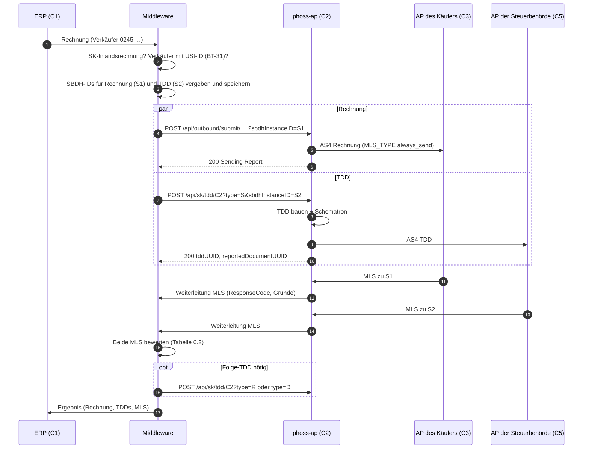
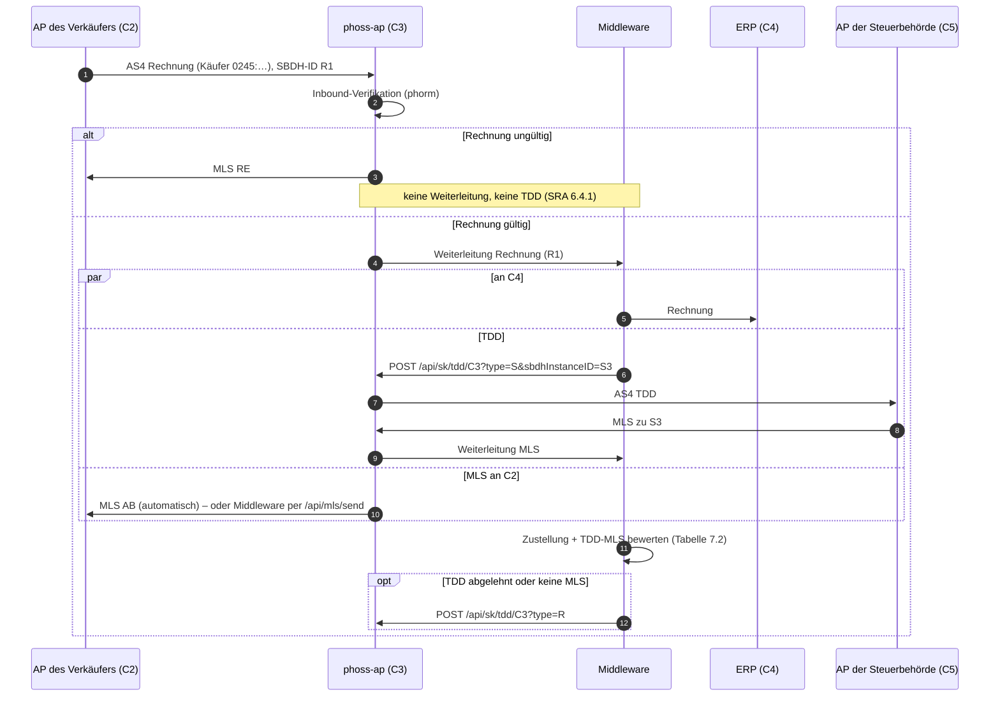

# Peppol SK – TDD-APIs und Prozess für die Middleware

Diese Seite beschreibt, wie die Middleware die slowakische Steuermeldung (**SK Tax Data Document,
TDD**) über den Access Point abwickelt: welche APIs der AP dafür anbietet und welchen Prozess die
Middleware als **C2** (AP des Verkäufers) und als **C3** (AP des Käufers) befolgen muss.

- **Fachliche Grundlage:** OpenPeppol, *Slovakia Solution Reference Architecture* (SRA) v1.2.
  Kapitel- und Seitenangaben unten beziehen sich darauf.
- **Analyse und Lückenliste:** [FR-008](https://github.com/RostigerN4gel/peppol-helper/blob/main/docs/feature-requests/FR-008-peppol-sk-tax-reporting.md)
  im Repository peppol-helper.
- **Umsetzung im AP:** [CUSTOMIZATIONS.md – Peppol SK TDD](CUSTOMIZATIONS.md#peppol-sk-tax-data-document-tdd-fork-specific).
- **English version:** [SK-TDD-MIDDLEWARE-EN.md](SK-TDD-MIDDLEWARE-EN.md).

> [!IMPORTANT]
> Die TDD-Bibliothek (`com.helger.peppol:peppol-sk-tdd` 0.2.2) ist laut Autor noch *work in
> progress* für die Mitgliederbefragung (Member Review) der SK-TDD-Spezifikation. Datenmodell und
> Regeln können sich bis zum Start am **2027-01-01** noch ändern.

---

## 1. Wann gilt das?

Eine TDD ist nur nötig, wenn der AP **slowakische Endkunden** bedient (Teilnehmer
`iso6523-actorid-upis::0245:<DIČ>`) und eine **inländische** Rechnung zwischen zwei slowakischen
Parteien ausgetauscht wird. Rechnungen mit slowakischen Partnern ohne eigene SK-Endkunden brauchen
keine TDD (SRA Table 5).

| Rolle des AP | Wer meldet | Bedingung für eine TDD (SRA) |
|---|---|---|
| **C2** – wir senden die Rechnung | der Verkäufer (C1) | der Verkäufer hat eine USt-ID (BT-31) |
| **C3** – wir empfangen die Rechnung | der Käufer (C4) | die Rechnung ist gültig **und** der Käufer hat eine USt-ID (BT-48) |

Bis zum Ende der Übergangsphase (laut SRA 2030) sind grenzüberschreitende Rechnungen nicht zu
melden. Die Quellen widersprechen sich hier teilweise (FR-008, K1–K5). Die Middleware sollte diese
Regeln deshalb konfigurierbar halten.

---

## 2. Aufgabenteilung

| Aufgabe | AP | Middleware |
|---|---|---|
| Rechnung per AS4 senden / empfangen | ✅ | stößt an bzw. nimmt entgegen |
| MLS von C3 bzw. C5 empfangen und der Sendung zuordnen | ✅ (Status-API, Weiterleitung an die Middleware) | wertet aus |
| MLS an C2 senden (Rolle C3) | ✅ automatisch, optional per API | entscheidet bei `mls.sending.trigger=api` |
| TDD aus der Rechnung erzeugen (inkl. Invoice UUID v5) | ✅ `POST /api/sk/tdd` | ruft auf |
| TDD per Schematron validieren und an C5 senden | ✅ | – |
| Entscheiden, **ob und wann** eine TDD fällig ist (`S`, `R`, `D`) | – | ✅ |
| MLS von Rechnung und TDD **gemeinsam** bewerten (SRA Table 1 / 2) | – | ✅ |
| SLA-Timer und Folge-TDDs | – | ✅ |
| Verknüpfung Rechnung ↔ TDDs speichern, C1/C4 informieren | – | ✅ |

Der AP kennt **keine** Verbindung zwischen einer Rechnung und ihren TDDs. Jede TDD ist für ihn
eine eigenständige ausgehende Transaktion. Die Middleware muss die Verknüpfung selbst halten,
dafür liefert der AP die nötigen Kennungen (Kapitel 3).

---

## 3. Kennungen

| Kennung | Erzeugt von | Verwendung |
|---|---|---|
| **SBDH Instance Identifier der Rechnung** | Middleware (empfohlen) oder AP | Bezug der MLS von C3 zur Rechnung (C2). Bei C3: Bezug der MLS an C2 |
| **SBDH Instance Identifier der TDD** | Middleware (empfohlen) oder AP | Bezug der MLS von C5 zur TDD |
| **Invoice UUID v5** (`reportedDocumentUUID`) | AP beim Bau der TDD (SRA 9.2.3) | fachlicher Schlüssel der Rechnung. Bei C2 und C3 identisch, bei `S` und `R` derselbe |
| **TDD UUID** (`tddUUID`) | AP (zufällige UUID v4) oder Middleware | Kennung der einzelnen TDD, für jede TDD neu |
| AP-Transaktions-ID (`outboundTransactionID`) | AP | interne ID, für Status-Abfragen und Betrieb |

**Empfehlung:** Die Middleware vergibt die SBDH Instance Identifier selbst (Parameter
`sbdhInstanceID`, eine UUID) und speichert sie vor dem Aufruf. Dann kann sie jede eingehende MLS
sicher zuordnen, auch wenn die HTTP-Antwort des AP verloren geht.

Feste Werte (SRA 9.1–9.3):

| Was | Wert |
|---|---|
| Dokumenttyp der TDD | `busdox-docid-qns::urn:peppol:schema:sk-taxdata:1.0::TaxData##urn:peppol:taxdata:sk-1::1.0` |
| Prozess der TDD | `cenbii-procid-ubl::urn:peppol:taxreporting` |
| Empfänger der TDD (C5, Testpilot) | `iso6523-actorid-upis::0242:000357-TaxAuthority.SK` (im AP konfigurierbar) |
| Endkunden | `iso6523-actorid-upis::0245:<DIČ>` |
| Ersatzteilnehmer | `iso6523-actorid-upis::0245:9970300001` – nur TDD, keine Rechnung (SRA 5.5) |

---

## 4. Konfiguration des AP

```properties
# TDD-Endpunkt einschalten (Standard: aus, dann antwortet er mit 404)
sk.tdd.enabled=true
# Pflicht: dieser AP als Vertreter des Meldenden (SK-AP-Kennung, Schema 0242)
sk.tdd.reporters-representative.participant-id=iso6523-actorid-upis::0242:<ID>
# Standardwerte
#sk.tdd.tax-authority.participant-id=iso6523-actorid-upis::0242:000357-TaxAuthority.SK
#sk.tdd.tax-authority.id=SK
#sk.tdd.c1-country-code=SK

# Nicht setzen: Rechnungen und TDDs brauchen MLS_TYPE always_send (Standard)
#mls.type=

# Rolle C3: ungültige Rechnungen mit RE beantworten und NICHT weiterleiten (SRA 6.4.1)
verification.inbound.enabled=true
verification.inbound.rejection-forwarding=none

# Optional, Rolle C3: Middleware bestimmt die MLS an C2 selbst (Kapitel 7.1)
#mls.sending.trigger=api
```

- **`mls.type`:** Der AP schreibt den globalen `mls.type` in das SBDH **jeder** ausgehenden
  Sendung. Die SRA verlangt `ALWAYS_SEND` für jede TDD und empfiehlt es für SK-Rechnungen, weil
  bei `FAILURE_ONLY` „keine Nachricht“ nicht von „Nachricht verloren“ zu unterscheiden ist. Ist
  `mls.type` anders gesetzt, liefert `POST /api/sk/tdd` ein Feld `warning`.
- **Inbound-Verifikation:** Ohne sie leitet der AP auch ungültige Rechnungen an die Middleware
  weiter. Bei `mls.sending.trigger=auto` (Standard) hat er dann schon ein positives MLS gesendet,
  bevor die Middleware die Rechnung prüfen kann. Dazu kommt: Prüft phorm mit
  `verification.outbound.enabled=true` auch ausgehende Dokumente, gilt das ebenso für TDDs.
- **Neuer Upstream-Stand (0.13.2):** Für **eingehende** Rechnungen gilt der `MLS_TYPE` aus dem
  SBDH des Senders. Fehlt er, gilt `FAILURE_ONLY`, und der AP sendet als C3 kein positives MLS.

---

## 5. API-Referenz

Alle Aufrufe gehen gegen `https://<ap-host>` und brauchen den Header `X-Token: <phase4.api.requiredtoken>`.

### 5.1 `POST /api/sk/tdd/{reporterRole}` – TDD erzeugen und senden

Request-Body: die **UBL-2.1-Rechnung** (`Invoice`) oder **-Gutschrift** (`CreditNote`) als XML,
**ohne SBDH**. Als C3 bekommt die Middleware die Rechnung je nach Weiterleitung im SBD verpackt
(Kapitel 5.4) und muss vorher das Geschäftsdokument herauslösen.

| Parameter | Pflicht | Standard | Bedeutung |
|---|---|---|---|
| `reporterRole` (Pfad) | ja | – | `C2` (Meldung für den Verkäufer) oder `C3` (für den Käufer) |
| `type` | nein | `S` | `S` = submit, `R` = resubmit, `D` = disregard |
| `scope` | nein | `D` | `D` = inländisch, `IC` = innergemeinschaftlich, `INTL` = international |
| `reportingParty` | nein | `EndpointID` des Verkäufers (C2) bzw. Käufers (C3) | Peppol-ID des Meldenden. Ist auch der SBDH-Sender der TDD. Setzen, wenn die Rechnung keine passende `EndpointID` hat |
| `tddUUID` | nein | zufällige UUID v4 | UUID der TDD |
| `sbdhInstanceID` | nein | zufällig | SBDH Instance Identifier der TDD-Übertragung (empfohlen, Kapitel 3) |
| `send` | nein | `true` | `false` = Probelauf: nur bauen und prüfen, die TDD kommt als `tddXML` zurück, nichts wird gesendet |
| `custom1`…`custom3` | nein | – | max. 255 Zeichen, werden an der Transaktion gespeichert (z. B. eigene Vorgangsnummer) |

Beispiel:

```bash
curl -s -X POST \
     -H "X-Token: <token>" -H "Content-Type: application/xml" \
     --data-binary @invoice.xml \
     "https://<ap-host>/api/sk/tdd/C2?type=S&scope=D&sbdhInstanceID=7f1c2a9e-3b4d-4e5f-8a6b-1c2d3e4f5a6b&custom1=VORGANG-4711"
```

Antwort **200** (gesendet, AS4-Receipt von C5 erhalten):

```json
{
  "tddUUID": "0d6d1b5e-6c6e-4c55-9d07-3c2c1d1f8a10",
  "reportedDocumentUUID": "1780de4f-a87c-50cc-9d8a-f982abe36912",
  "taxDataTypeCode": "S",
  "documentScope": "D",
  "reporterRole": "C2",
  "reportingParty": "iso6523-actorid-upis::0245:2020123456",
  "receiver": "iso6523-actorid-upis::0242:000357-TaxAuthority.SK",
  "sbdhInstanceID": "7f1c2a9e-3b4d-4e5f-8a6b-1c2d3e4f5a6b",
  "outboundTransactionID": "…",
  "sendingReport": { … }
}
```

Zusätzliche Felder, falls zutreffend: `validationWarnings` (Schematron-Warnungen, die TDD wurde
trotzdem gesendet), `warning` (`mls.type` ist nicht `always_send`) und bei `send=false` das Feld
`tddXML` statt `sbdhInstanceID`, `outboundTransactionID` und `sendingReport`.

| HTTP | Bedeutung | Reaktion der Middleware |
|---|---|---|
| **200** | TDD gebaut, gültig und an C5 übertragen (AS4-Receipt) | `sbdhInstanceID`, `tddUUID` und `reportedDocumentUUID` speichern, auf die MLS von C5 warten |
| **400** | Parameter ungültig, Body ist keine UBL-Rechnung/-Gutschrift, Meldender ohne `EndpointID` | Aufruf korrigieren. Kein Retry ohne Änderung |
| **401** | Token fehlt oder ist falsch | Konfiguration prüfen |
| **404** | `sk.tdd.enabled=false` oder Senden im AP abgeschaltet | AP-Betrieb informieren |
| **422 ohne `outboundTransactionID`** | TDD nicht baubar (Pflichtfeld fehlt), Schematron-Fehler (`issues`) oder Outbound-Verifikation hat abgelehnt | Rechnung bzw. Daten korrigieren. **Nichts wurde gesendet** |
| **422 mit `outboundTransactionID`** | TDD angenommen, aber der **erste Sendeversuch** an C5 ist gescheitert (`sendingReport`) | **Nicht neu einreichen.** Der AP wiederholt selbst (`retry.sending.*`). Status per 5.2 verfolgen |
| **500** | AP-Konfiguration fehlt oder ist falsch (z. B. `reporters-representative`) | AP-Betrieb informieren |

### 5.2 `GET /api/outbound/status/{sbdhInstanceID}` – Status einer Sendung

Gilt für die Rechnung (C2) und für jede TDD. Wichtige Felder:

| Feld | Werte |
|---|---|
| `status` | `pending`, `sending`, `sent`, `failed` (der AP wiederholt, `nextRetryDT`), `permanently_failed` (endgültig nicht zustellbar), `rejected` (von der Outbound-Verifikation abgelehnt) |
| `mlsStatus` | `pending` (noch keine MLS), `received_ap`, `received_ab`, `received_re` |
| `errorDetails` | letzter Fehler bei `failed` / `permanently_failed` |
| `custom1`…`custom3` | die beim Einreichen übergebenen Werte |

`mlsStatus` liefert nur den Antwortcode. Den **Grund** einer Ablehnung (z. B. `FD`) sieht die
Middleware nur in der MLS selbst (5.4).

### 5.3 `POST /api/outbound/submit/{senderID}/{receiverID}/{docTypeID}/{processID}/{c1CountryCode}` – Rechnung senden (C2)

Die vorhandene Schnittstelle für ausgehende Dokumente, unverändert. Für SK-Rechnungen:
`senderID` = `0245:<DIČ des Verkäufers>`, `c1CountryCode` = `SK`, `sbdhInstanceID` selbst vergeben.
Details in der OpenAPI-Beschreibung unter `/openapi/v3/api-docs`.

### 5.4 Weiterleitung an die Middleware: Rechnungen **und** MLS

Der AP leitet jedes empfangene Dokument an die Middleware weiter, also auch **eingehende MLS**,
d. h. die MLS von C3 zu unserer Rechnung und die MLS von C5 zu unserer TDD. Daran erkennt die
Middleware eine MLS:

| Weiterleitung (`forwarding.mode`) | Body | MLS erkennen an |
|---|---|---|
| `http_post_sync` / `http_post_async` | das komplette SBD (XML), Header `X-SBDH-Instance-ID`, `X-phoss-AP-Transaction-ID` | SBDH-Dokumenttyp bzw. Wurzelelement `ApplicationResponse` mit `CustomizationID` `urn:peppol:edec:mls:1.0` |
| `spi` / `middleware-data` | `InboundPeppolRequest`-XML | `DocumentTypeInstanceIdentifier` = Peppol-MLS-1.0-Dokumenttyp |

Auszuwertende Felder der MLS (Peppol MLS 1.0, UBL `ApplicationResponse`):

| Feld (XPath ab `ApplicationResponse`) | Bedeutung |
|---|---|
| `cac:DocumentResponse/cac:DocumentReference/cbc:ID` | SBDH Instance Identifier **unserer** Sendung (Rechnung oder TDD) → Zuordnung |
| `cac:DocumentResponse/cac:Response/cbc:ResponseCode` | `AP` (angenommen), `AB` (angenommen, Zustellung nicht bestätigt), `RE` (abgelehnt) |
| `cac:DocumentResponse/cac:LineResponse/cac:Response/cac:Status/cbc:StatusReasonCode` | Grund bei `RE`: `BV` (Geschäftsregel verletzt), `BW` (Warnung), `SV` (Syntax), **`FD` (Zustellung an C4 gescheitert)** |
| `cac:DocumentResponse/cac:LineResponse/cac:Response/cbc:Description` | Klartext zum Grund |

Ob das Dokument der Rechnungs- oder der TDD-Sendung gilt, ergibt sich aus der gespeicherten
SBDH-Zuordnung (Kapitel 3), alternativ aus dem Absender (C5 = `0242:000357-TaxAuthority.SK`).

### 5.5 `POST /api/mls/send` – MLS an C2 senden (Rolle C3, nur bei `mls.sending.trigger=api`)

```json
{
  "sbdhInstanceID": "<SBDH Instance Identifier der empfangenen Rechnung>",
  "responseCode": "RE",
  "responseText": "Delivery to the buyer failed",
  "issues": [ { "statusReasonCode": "FD", "errorField": "NA", "description": "Buyer system not reachable" } ]
}
```

Antwort: `status` = `sent` (oder `recorded`, wenn der Sender `FAILURE_ONLY` angefordert hat und
der Code `AP`/`AB` ist). `409`: Für diese Rechnung ist schon eine MLS festgelegt. Pro Rechnung
gibt es genau **eine** MLS. Ohne Aufruf sendet der AP nach `mls.sending.api.timeout` (Standard 5 min
nach Empfang) selbst eine Ersatz-MLS (`mls.sending.api.timeout.code`, Standard `AB`).

---

## 6. Prozess als C2 (wir senden die Rechnung)

### 6.1 Ablauf



Schritte:

1. **Prüfen, ob gemeldet werden muss** (Kapitel 1). Nein → nur die Rechnung senden, fertig.
2. **Kennungen vergeben:** SBDH-ID `S1` für die Rechnung, `S2` für die TDD. Zusammen mit der
   Rechnung speichern (Status „in Übertragung“).
3. **Rechnung senden** (5.3) und **TDD senden** (5.1, `type=S`). Die SRA erlaubt beides parallel
   (C2-FLOW-01). Wer zuerst die TDD-Antwort abwarten will, um eine ungültige TDD vor dem Versand
   der Rechnung zu erkennen, kann sequentiell vorgehen. Ein `422` ohne `outboundTransactionID`
   bei der TDD bedeutet: Rechnung bzw. Mapping korrigieren.
4. `reportedDocumentUUID` speichern, das ist der dauerhafte Schlüssel der Rechnung.
5. **MLS zuordnen:** jede weitergeleitete MLS (5.4) über `DocumentReference/ID` zu `S1` oder `S2`
   und den Status fortschreiben.
6. **Bewerten und nachfassen** nach 6.2, Timer nach Kapitel 8.
7. **C1 informieren**, sobald ein Endzustand erreicht ist (SRA 5.2).

### 6.2 Bewertung und Folge-TDD (SRA 5.3–5.4, Table 1)

| MLS von C3 (Rechnung) | MLS von C5 (TDD) | Zustand | Aktion der Middleware |
|---|---|---|---|
| `AP` oder `AB` | `AP` | **gemeldet** (Endzustand) | C1 Erfolg melden |
| `AP` oder `AB` | `RE` | zugestellt, nicht gemeldet | TDD-Fehler (`issues`/MLS-Gründe) beheben, **TDD `R`** senden |
| `AP` oder `AB` | keine MLS innerhalb der SLA | zugestellt, nicht gemeldet | **TDD `R`** senden |
| `RE` (Rechnung ungültig, z. B. `BV`/`SV`) | beliebig | nicht zugestellt | C1 korrigiert die Rechnung → neue Rechnung an C3 **und TDD `R`** |
| `RE` mit **`FD`** (C4 nicht erreichbar) | beliebig | nicht zugestellt | **TDD `D`** senden (Meldung verwerfen) |
| keine MLS innerhalb der SLA | beliebig | unklar | Rechnung erneut senden + **TDD `R`**, oder abbrechen + **TDD `D`** |
| – | `RE` auf eine TDD `R`/`D` | Folgefehler | Fehler beheben und erneut senden. Bei Wiederholung Fachbereich einschalten |

Regeln für Folge-TDDs:

- Eine Folge-TDD wird aus **derselben** Rechnung erzeugt (`reportedDocumentUUID` bleibt gleich)
  und bekommt eine **neue** `tddUUID` und eine **neue** SBDH-ID.
- Bei einer **korrigierten Rechnung** (neue Rechnungsnummer oder neues Datum) entsteht eine neue
  `reportedDocumentUUID`. Die alte Meldung ist dann über `D` zu verwerfen, wenn sie nicht mehr gilt.
  Die genaue Abgrenzung zwischen „`R` mit korrigierter Rechnung“ und „`D` + neue `S`“ ist in den
  Quellen nicht eindeutig. Vor dem Produktivstart klären.
- **Ersatzteilnehmer** `0245:9970300001` (Käufer nicht per Peppol erreichbar, SRA 5.5): **keine**
  Rechnung senden, nur die TDD (`type=S`).

---

## 7. Prozess als C3 (wir empfangen die Rechnung)

### 7.1 Ablauf



Schritte:

1. **Ungültige Rechnungen** beantwortet der AP selbst mit `RE` und leitet sie nicht weiter, sofern
   die Inbound-Verifikation aktiv ist (Kapitel 4). Die Middleware bekommt sie dann gar nicht.
   **Ohne** Verifikation muss die Middleware selbst prüfen und darf für eine ungültige Rechnung
   **keine TDD** senden.
2. Für eine gültige Rechnung prüfen, ob gemeldet werden muss: Käufer mit USt-ID (BT-48),
   Inlandsrechnung, und die Käufermeldung ist im betreffenden Zeitraum nicht ausgesetzt (FR-008, K5).
3. Rechnung an C4 zustellen und **TDD senden** (5.1, `reporterRole=C3`, `type=S`). Die Rechnung
   ohne SBDH übergeben (Kapitel 5.1). `reportingParty` setzen, falls die `EndpointID` des Käufers
   nicht seine `0245`-Kennung ist.
4. **MLS an C2:** Standardmäßig sendet der AP nach erfolgreicher Weiterleitung automatisch `AB`
   (Fork-Verhalten). Kann die Middleware die Rechnung **nicht an C4 zustellen**, verlangt die
   SRA ein `RE` mit Grund `FD`. Das geht nur mit `mls.sending.trigger=api`: Dann sendet die
   Middleware die MLS selbst (5.5), `AB`/`AP` nach Zustellung bzw. `RE` + `FD` bei Misserfolg.
   `mls.sending.trigger` gilt global für alle Empfänge.
5. MLS von C5 zur TDD zuordnen und nach 7.2 bewerten.
6. C4 informieren: Rechnung, TDDs und deren MLS (SRA 6.2).

### 7.2 Bewertung (SRA 6.3, Table 2)

| Zustellung an C4 | MLS von C5 (TDD) | Aktion der Middleware |
|---|---|---|
| erfolgreich | `AP` | Endzustand, C4 informieren |
| erfolgreich | `RE` | Fehler beheben, **TDD `R`** |
| erfolgreich | keine MLS innerhalb der SLA | **TDD `R`** |
| gescheitert | beliebig | MLS `RE` + `FD` an C2 (nur mit `mls.sending.trigger=api`). Ob die eigene TDD zu verwerfen ist (`D`), ist in der SRA nicht eindeutig geregelt – vor dem Produktivstart klären |

Ein **TDD-Fehler** ändert die MLS an C2 nicht: Die MLS bewertet nur Gültigkeit und Zustellung der
Rechnung (SPOG MLS: genau eine MLS pro Dokument). Ein TDD-Problem wird über `R` und eine
interne Meldung gelöst (FR-008, offene Frage 3).

---

## 8. Fristen und Timer

Die Middleware muss die Fristen selbst überwachen. Der AP stößt keine Folge-TDDs an.

| Frist | Wert (Testbed, SRA Appendix C) | Bei Überschreitung |
|---|---|---|
| MLS von C3 zur Rechnung | 10 min nach dem Senden | Tabelle 6.2, Zeile „keine MLS“ |
| MLS von C5 zur TDD | 15 min nach dem Senden | TDD `R` |
| TDD nach Validierung der Rechnung | 15 min | interne Eskalation (Budget der SRA) |

Die Produktivwerte können abweichen, deshalb alle Fristen konfigurierbar halten. Zusätzlich gilt
die allgemeine Peppol-Vorgabe MLS-1: 99,5 % aller MLS innerhalb von 20 Minuten.

---

## 9. Fehlerbehandlung und Wiederholungen

- **Sendefehler zählen nicht als MLS.** Ein `failed` bei 5.2 bedeutet: Der AP wiederholt die
  Übertragung selbst. Erst `permanently_failed` ist endgültig. Dann eine **neue** TDD
  einreichen (neue `tddUUID`, neue SBDH-ID), beim ersten Versuch `type=S`.
- **Nie dieselbe SBDH-ID zweimal einreichen.** Jede TDD und jede neu gesendete Rechnung braucht
  eine neue SBDH-ID. C5 und C3 erkennen sonst ein Duplikat.
- **Verlorene HTTP-Antwort** beim Einreichen: Mit selbst vergebener SBDH-ID per 5.2 prüfen, ob
  die Sendung existiert, statt blind neu einzureichen.
- **Probelauf:** `send=false` eignet sich für Tests des Mappings und für eine Vorabprüfung vor dem
  Versand der Rechnung, ohne dass etwas an C5 geht.

---

## 10. Einschränkungen und offene Punkte

- Die TDD enthält **keinen Verweis auf das SBDH der Rechnungsübertragung** (SRA S. 40). Der Builder
  von `peppol-sk-tdd` 0.2.2 hat kein Feld dafür (FR-008, offene Frage 2).
- Der AP liefert den **Grund** einer abgelehnten MLS nicht in der Status-API (5.2), sondern nur in
  der weitergeleiteten MLS (5.4).
- `mls.type` und `mls.sending.trigger` gelten **global**. Es gibt keine Einstellung pro Sendung.
- Ob TDDs und ihre MLS in die Peppol-Reports (TSR/EUSR) einfließen, ist nicht geklärt (FR-008,
  offene Frage 4). Der AP zählt sie derzeit wie jede andere Sendung.
- Akkreditierung, Registrierung im zentralen SK-SMP, Endkunden-Token und Testbed sind nicht Teil
  dieser Schnittstelle (FR-008, „Out of scope“).
- Die Quellenkonflikte K1–K5 (u. a. grenzüberschreitende Meldung, Aussetzung der Käufermeldung)
  sind offen und sollten vor dem Produktivstart fachlich entschieden werden.
